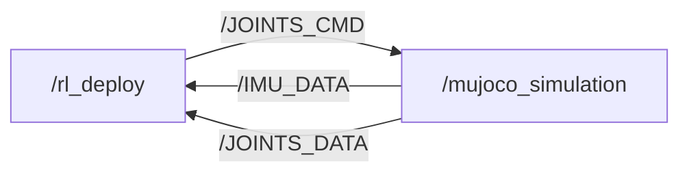

# M20 SDK Deploy

[](https://discord.gg/gdM9mQutC8)

## 1. Overview

Watch the M20 tutorial video on [YouTube](https://youtu.be/5VKMahWWYM4?si=eibPMX5fNgEV5S13) or [Bilibili](https://b23.tv/CSEyYvw).

This repository uses ROS2 to implement the entire Sim-to-sim and Sim-to-real workflow. Therefore, ROS2 must first be installed on your computer, such as installing [ROS2 Humble](https://docs.ros.org/en/humble/index.html) on Ubuntu 22.04. We've also released an introduction [video](https://www.youtube.com/watch?v=FNaxsDBtD7A), please check it out! Please go through the whole process on a Ubuntu system.

The following listings show the low-level ROS 2 communication; control commands are described in the control interfaces section below.

```bash
# ros2 topic list
/BATTERY_DATA
/IMU_DATA
/JOINTS_CMD
/JOINTS_DATA
/parameter_events
/rosout

# ros2 node info /mujoco_simulation 
/mujoco_simulation
  Subscribers:
    /JOINTS_CMD: drdds/msg/JointsDataCmd
  Publishers:
    /IMU_DATA: drdds/msg/ImuData
    /JOINTS_DATA: drdds/msg/JointsData
    /parameter_events: rcl_interfaces/msg/ParameterEvent
    /rosout: rcl_interfaces/msg/Log
  Service Servers:
    /mujoco_simulation/describe_parameters: rcl_interfaces/srv/DescribeParameters
    /mujoco_simulation/get_parameter_types: rcl_interfaces/srv/GetParameterTypes
    /mujoco_simulation/get_parameters: rcl_interfaces/srv/GetParameters
    /mujoco_simulation/list_parameters: rcl_interfaces/srv/ListParameters
    /mujoco_simulation/set_parameters: rcl_interfaces/srv/SetParameters
    /mujoco_simulation/set_parameters_atomically: rcl_interfaces/srv/SetParametersAtomically
  Service Clients:

  Action Servers:

  Action Clients:

# ros2 node info /rl_deploy 
/rl_deploy
  Subscribers:
    /BATTERY_DATA: drdds/msg/BatteryData
    /IMU_DATA: drdds/msg/ImuData
    /JOINTS_DATA: drdds/msg/JointsData
    /parameter_events: rcl_interfaces/msg/ParameterEvent
  Publishers:
    /JOINTS_CMD: drdds/msg/JointsDataCmd
    /parameter_events: rcl_interfaces/msg/ParameterEvent
    /rosout: rcl_interfaces/msg/Log
  Service Servers:
    /rl_deploy/describe_parameters: rcl_interfaces/srv/DescribeParameters
    /rl_deploy/get_parameter_types: rcl_interfaces/srv/GetParameterTypes
    /rl_deploy/get_parameters: rcl_interfaces/srv/GetParameters
    /rl_deploy/list_parameters: rcl_interfaces/srv/ListParameters
    /rl_deploy/set_parameters: rcl_interfaces/srv/SetParameters
    /rl_deploy/set_parameters_atomically: rcl_interfaces/srv/SetParametersAtomically
  Service Clients:

  Action Servers:

  Action Clients:

```

## 2. Contribution

Everyone is welcome to contribute to this repo. If you discover a bug or optimize our training config, just submit a pull request and we will look into it.

## 3. Sim-to-sim

```bash
pip install "numpy < 2.0" mujoco scipy
git clone https://github.com/DeepRoboticsLab/sdk_deploy.git

# Compile
cd sdk_deploy
source /opt/ros/<ros-distro>/setup.bash
colcon build --packages-up-to m20_sdk_deploy --cmake-args -DBUILD_PLATFORM=x86
```

Start the simulator in Terminal 2 before starting the controller in Terminal 1.
For simultaneous robots, use separate DDS domains for all their joint and IMU topics.

```bash
# Run (Open 2 terminals)
# Terminal 1
export ROS_DOMAIN_ID=1
source install/setup.bash
ros2 run m20_sdk_deploy rl_deploy

# Terminal 2 
export ROS_DOMAIN_ID=1
source install/setup.bash
python3 src/M20_sdk_deploy/interface/robot/simulation/mujoco_simulation_ros2.py
```

### 3.1. Control

For Sim-to-sim tests, use only the keyboard or ROS 2 interface. Refer to [Control interfaces](#5-control-interfaces) for selection instructions and commands.

<span style="color: red;">**Note:**</span>
> - Right click simulator window and select "always on top"
> - When the robot dog stands up, it may become stuck due to self-collision in the simulation. This is not a bug; please try again.

### 3.2. MuJoCo 关节测试台

`m20_joint_bench` 用 `--sim` 启动 MuJoCo，用 `--hardware` 连接实机。两种模式共用 C++ 控制器，关节零位、正方向和机械限位都按 `M20_Pro/urdf/M20.urdf`。仿真固定机身，使用本机 DDS 发现和 `/m20_joint_bench_sim/` 话题。命令、增益与退出条件见 [关节测试台命令](#42-m20-pro-实机关节测试台)。

在 NUC 的 `sdk_deploy` 根目录构建。首次配置 MuJoCo Python 环境可参考下节。

```bash
source /opt/ros/jazzy/setup.bash
colcon build --packages-up-to m20_sdk_deploy --cmake-args -DM20_JOINT_BENCH_ONLY=ON
source install/setup.bash
source .venv/bin/activate
ros2 run m20_sdk_deploy m20_joint_bench --sim
```

无桌面时用 `ros2 run m20_sdk_deploy m20_joint_bench --sim --headless`。只开一个终端即可，`quit` 会退出控制器和仿真。仿真端收到指令时按消息里的目标和增益计算力矩，断流 0.5 秒后保持当前腿角，轮速目标归零。

### 3.3. 旧版 MuJoCo Joint Demo

此 demo 仅用于 MuJoCo：机身固定，四轮离地；可逐个设置 12 个腿关节的目标角度和 4 个轮电机的目标速度。不要同时启动 `rl_deploy`。demo 和仿真使用本机 DDS 发现以及专用 `/m20_joint_demo_sim/` 话题，不使用实机话题。

从仓库根目录执行一次（示例使用 ROS 2 Jazzy）。已有能导入 `mujoco`、`numpy` 和 `scipy` 的 ROS 2 Python 环境时，跳过虚拟环境创建和安装：

```bash
source /opt/ros/jazzy/setup.bash
colcon build --packages-select drdds
python3 -m venv --system-site-packages .venv
source .venv/bin/activate
python3 -m pip install 'numpy<2' 'mujoco==3.3.7' scipy
```

Ubuntu 上如果创建虚拟环境时提示缺少 `ensurepip`，先安装 `python3-venv`。

两个终端分别执行以下准备命令（使用已有 Python 环境时改为激活该环境）：

```bash
source /opt/ros/jazzy/setup.bash
source install/setup.bash
source .venv/bin/activate
export ROS_DOMAIN_ID=52
```

终端 1 启动固定基座仿真；无桌面时，把 `SDK_SIM_HEADLESS=1` 加在命令开头：

```bash
M20_SIM_JOINT_DEMO=1 python3 src/M20_sdk_deploy/interface/robot/simulation/mujoco_simulation_ros2.py
```

终端 2 启动交互控制：

```bash
python3 src/M20_sdk_deploy/interface/robot/simulation/m20_joint_demo.py
```

| 在 `m20>` 输入 | 行为 |
| --- | --- |
| `status`、`limits` | 查看 16 路目标和反馈，或查询当前仿真坐标下的角度、轮速范围。 |
| `arm` | 有新鲜反馈时才启用：保持当前腿关节角度，轮速目标置零。 |
| `jog fl_hipx +2deg` | 将左前髋侧摆的目标角度增加 2°；其他通道目标不变。 |
| `pos fl_hipx 24deg` | 将左前髋侧摆目标设为 24°；其他关节的绝对角度请先查 `limits`。 |
| `wheel fr 0.5rad/s` | 右前轮目标速度为 0.5 rad/s，2 秒后自动归零；负值反向。 |
| `stop` | 以当前反馈角度保持腿关节并将轮速目标置零，仍可继续操作。 |
| `disarm`、`quit` | 停止发布，或退出。仿真端在指令断流 0.5 秒后保持腿关节并将轮速目标归零。 |

腿的命名为 `fl/fr/hl/hr`（左前、右前、左后、右后）加 `_hipx/_hipy/_knee`；轮速命令只输入腿名。`pos` 和 `jog` 的数值默认是度，`wheel` 默认是 rad/s。

## 4. Sim-to-Real

This process is almost identical to simulation-simulation. You only need to add the step of connecting to Wi-Fi to transfer data, and then modify the compilation instructions.Real-robot control supports keyboard, gamepad, and ROS 2 input. Select the desired `RemoteCommandType` in `main.cpp` and rebuild; the default is `kKeyBoard`.

**Please first use the OTA upgrade function in the handle settings to upgrade the hardware to version 1.1.8. We require a sdk authentication code to activate the sdk mode. Please contact our technical support team to get this unique code for each robot.**

```bash

# computer and gamepad should both connect to WiFi
# WiFi: CA9B********
# Passward: 12345678 (If wrong, contact technical support)
# Note: If you are connected via the second WiFi, use 10.21.41.1 instead of 10.21.31.103
#       for ssh/scp below. It is the same robot, only the IP differs per WiFi network.

# Run these commands from the local SDK workspace root (the directory containing src/).
# Include the updated drdds source to generate RobotStatus in the workspace.
ssh user@10.21.31.103 'mkdir -p ~/M20_sdk_deploy/src'
scp -r src/drdds src/M20_sdk_deploy user@10.21.31.103:~/M20_sdk_deploy/src/

# ssh connect for remote development, 
ssh user@10.21.31.103
cd M20_sdk_deploy
source /opt/ros/foxy/setup.bash #source ROS2 env
# Build drdds and the SDK into this workspace; keep the firmware installation
# under /opt/ros/foxy unchanged. Source this workspace when running the new SDK.
colcon build --packages-up-to m20_sdk_deploy --cmake-args -DBUILD_PLATFORM=arm

sudo su # Root
source /opt/ros/foxy/setup.bash #source ROS2 env
source /opt/robot/scripts/setup_ros2.sh
# Use the gamepad to enable SDK mode. Need authorization code, please contact technical support team.

# Run
source install/setup.bash
ros2 run m20_sdk_deploy rl_deploy

# exit sdk mode：
# Use the gamepad to enable SDK mode.
```

### 4.1. M20 Pro 逐电机测试前的只读检查

`scripts/m20_preflight.py` 只订阅固件的 `/JOINTS_DATA` 和 IMU，不创建电机指令发布者，也不初始化驱动。M20 Pro 默认读取 `/IMU`（`sensor_msgs/msg/Imu`）；仍使用旧 SDK 消息的设备可传 `--imu-topic /IMU_DATA`（`drdds/msg/ImuData`）。它检查反馈是否持续更新，并显示 16 路原始位置、速度、力矩、温度和状态字。表中的关节名是本 SDK 预期的通道顺序，不是从固件确认的映射；报告 `PASS` 只表示遥测流正常，不代表 IMU 姿态可用或可以接管运控。

连接机器人热点后，在 NUC 的仓库根目录把脚本复制到 AOS（将 `user` 替换为自己的 AOS 登录名）：

```bash
scp src/M20_sdk_deploy/scripts/m20_preflight.py user@10.21.31.103:~/m20_preflight.py
ssh user@10.21.31.103
```

下面的命令在 **AOS 的 SSH 会话**中运行。只读取信息，不启动 `rl_deploy`，也不切换 SDK 模式；不要复制仿真用的 ROS 2 域配置。若该设备的 ROS 版本或厂商环境脚本不同，先按厂商说明确认实际环境。

```bash
uname -m
cat /etc/os-release
source /opt/ros/foxy/setup.bash
source /opt/robot/scripts/setup_ros2.sh
python3 ~/m20_preflight.py --seconds 5 --imu-topic /IMU
```

若导入 `drdds` 失败，或当前模式下没有反馈，保留报错或报告，先核对该固件的消息包和遥测开放条件；不要通过启动运控或改变固件模式来排查。

### 4.2. M20 Pro 实机关节测试台

`m20_joint_bench` 是独立终端程序，不启动 RL，也不发送整组清故障或使能指令。它使用 `/JOINTS_DATA` 和 `/IMU` 检查反馈；IMU 只用于检查流是否正常，不猜测坐标轴，也不做整机平衡。仅用于厂商认可的实机测试支撑，机身有可靠支撑、四轮离地、手柄急停随手可用。不要和其他自定义运控节点并行运行。

从 NUC 的仓库根目录复制源码到 AOS 的 `~/sdk_deploy`（替换为实际可用的 SSH 登录地址）。如果要全量替换，请先退出旧控制节点，并清理旧工作区或将它移出目标路径，避免新旧源码和构建产物混在一起。

```bash
ssh user@10.21.31.103 'mkdir ~/sdk_deploy'
scp -r src README.md LICENSE user@10.21.31.103:~/sdk_deploy/
ssh user@10.21.31.103
```

若 `mkdir` 提示目录已存在，先不要继续复制。下面的命令在 AOS 的新 SSH 会话中运行，不加载旧工作区。只编译手动节点，直接使用 Foxy 下固件自带的 `drdds`，不需要 ONNX Runtime 或交叉编译器：

```bash
cd ~/sdk_deploy
source /opt/ros/foxy/setup.bash
colcon build --base-paths src/M20_sdk_deploy --packages-select m20_sdk_deploy --cmake-args -DM20_JOINT_BENCH_ONLY=ON
source /opt/robot/scripts/setup_ros2.sh
source install/local_setup.bash
ros2 run m20_sdk_deploy m20_joint_bench
```

默认只读，输入 `status` 应看到 `joints=live`、`IMU=live`。在手柄确认 SDK 模式已开启后，先在此模式确认 `other command traffic=quiet`。端点计数不必为零，但持续收到其他关节指令时不要继续。`quit` 退出，再明确开启交互写入模式：

```bash
ros2 run m20_sdk_deploy m20_joint_bench --hardware
```

| 命令 | 预期结果 |
| --- | --- |
| `arm` | 有连续反馈、16 路驱动状态正常、观察窗口无其他指令、且找到接收端时，捕获当前腿姿与轮速零目标；等到终端显示 `Armed`。 |
| `limits` | 显示 12 个腿关节的 URDF 机械限位和可设目标范围，单位为度。 |
| `jog fl_hipx +20deg` | 按 URDF 正方向在当前目标上加 20°，超出可设范围时裁到边界并提示。 |
| `pos fl_hipx 25deg` | 将左前髋侧摆的 URDF 绝对目标设为 25°，超出可设范围时裁到边界并提示。 |
| `stop` | 将轮速目标置零、保持当前腿姿，并允许运动到另一通道。 |
| `wheel fr 0.3rad/s` | 右前轮速度目标保持为 `0.3 rad/s`，不会定时回零。用 `wheel fr 0` 或 `stop` 将目标置零。 |
| `disarm` / `quit` | 正常退出控制时发约 250 ms 阻尼再停止发布；`quit` 还会退出程序。 |

腿关节在 `arm` 状态使用 `Kp=200`、`Kd=2.5`，轮电机和释放控制时的阻尼保持 `Kp=0`、`Kd=1`。`pos` 和 `jog` 的目标范围为 URDF 下限加 5°、上限减 5°。一次指令可以跨过整个可设范围，下发的腿关节目标仍以 5°/s 逐步靠近。轮速目标限制在 ±2 rad/s，一次只试一个电机。

`arm` 和 `stop` 捕获实测角度作为保持目标。若当前角度已经进入机械限位内侧的 5° 余量，保持动作不会主动把关节拉回。任一腿关节反馈越过 URDF 机械限位时，程序拒绝 `arm` 或释放已有控制。腿关节实测转速超过 0.8 rad/s、轮电机实测转速超过 2.5 rad/s，也会释放控制。`status` 用 URDF 方向显示绝对角度和实测转速。

控制循环目标 200 Hz，终端空闲不会退出 `arm`，轮速目标也不会自动归零。结束时用 `disarm` 或 `quit` 释放控制，`stop` 只停止动作。关节或 IMU 反馈失效时仍会退出。`status` 显示目标和实际反馈，PD 控制不保证实际角度恰好等于目标。不要在 `arm` 前另开 `/JOINTS_CMD` 的订阅工具：接收端检查只计数，无法确认额外的订阅者就是固件，观测请用 `/JOINTS_DATA`。监测到其他指令源时，程序停止自身输出。掉电、崩溃或网络中断时，不能保证最后一帧到达，不用 `Ctrl+C` 替代手柄急停。正常结束后按手柄流程退出 SDK 模式。

`--test` 只使用 `/m20_joint_bench_test/` 话题，供离线模拟反馈验证，不连接真实关节指令话题。

### 4.3. 持续查看 16 路位置和速度

`scripts/m20_joint_monitor.py` 只订阅 `/JOINTS_DATA`，默认每秒刷新终端 5 次。显示原始位置（rad 和 °）、原始角速度（rad/s）及反馈新鲜度，不套用 SDK 的方向或零位变换。断流时标记 `STALE` 并保留最后一帧；时间戳停止更新时显示 `STAMP NOT ADVANCING`。

在 NUC 的 `sdk_deploy` 根目录，复制到 AOS 已部署的同名工作区：

```bash
scp src/M20_sdk_deploy/scripts/m20_joint_monitor.py user@10.21.31.103:~/sdk_deploy/src/M20_sdk_deploy/scripts/
```

在 AOS 的 SSH 会话中执行。只用固件自带的 `drdds`，不用重新编译，也不用启动控制器或输入 `arm`：

```bash
source /opt/ros/foxy/setup.bash
source /opt/robot/scripts/setup_ros2.sh
python3 ~/sdk_deploy/src/M20_sdk_deploy/scripts/m20_joint_monitor.py --hz 5
```

按 `Ctrl+C` 退出监视器，不影响运控进程。需要追加打印每次刷新的快照而不是原地刷新时，可加 `--plain`。

## 5. Control interfaces

Use the build and deployment steps above before selecting an input method; the
default selection in `main.cpp` is `kKeyBoard`.

### 5.1. Keyboard

To use keyboard control, set `RemoteCommandType::kKeyBoard` (`0`) in [main.cpp](main.cpp), rebuild, and restart the SDK.

Press the following keys in the terminal running `rl_deploy`:

- z： default position
- c： rl control default position
- x： lie down
- wasd：forward/leftward/backward/rightward
- qe：counter clockwise/clockwise

### 5.2. Gamepad

To use gamepad control, set `RemoteCommandType::kGamepad` (`1`) in [main.cpp](main.cpp), rebuild, and restart the SDK.

*(Note: When using the gamepad control function, please ensure that the Gamepad APP version is V1.5.11 or higher.)*


- L1： default position
- L2： rl control default position
- R1： lie down
- R2： joint damping
- Left joystick：forward/leftward/backward/rightward
- Right joystick：clockwise/counter clockwise

### 5.3. ROS 2

To use ROS 2 control, set `RemoteCommandType::kRos2` (`2`) in [main.cpp](main.cpp), rebuild, and restart the SDK.

Start the controller with `ros2 run m20_sdk_deploy rl_deploy`; in another
terminal, source the same ROS/workspace environment and use the same DDS domain.
For the Sim-to-sim setup above, run `export ROS_DOMAIN_ID=1` in this command terminal too.

**Stand up:**

```bash
ros2 topic pub --once /rl_deploy/command_state std_msgs/msg/String '{data: stand}'
```

**Enter policy control after standing has finished:**

```bash
ros2 topic pub --once /rl_deploy/command_state std_msgs/msg/String '{data: rl_control}'
```

**Simulation movement example (forward at a requested 0.1 m/s):**

```bash
ros2 topic pub --rate 50 /rl_deploy/cmd_vel geometry_msgs/msg/Twist \
  '{linear: {x: 0.1, y: 0.0}, angular: {z: 0.0}}'
```

Use `linear.x` for forward/backward (m/s), `linear.y` for left/right (m/s), and
`angular.z` for counterclockwise/clockwise yaw (rad/s); other axes must be zero.
Nonzero velocity is used only in policy control. Press Ctrl+C to stop publishing;
after 0.25 seconds without velocity input, the effective command becomes zero.

**Lie down:**

```bash
ros2 topic pub --once /rl_deploy/command_state std_msgs/msg/String '{data: lie_down}'
```

**Request joint damping:**

```bash
ros2 topic pub --once /rl_deploy/command_state std_msgs/msg/String '{data: damping}'
```

**Read current state, commands, joint data, and base orientation/angular velocity:**

```bash
ros2 topic echo /rl_deploy/status
# In a separate terminal, check the effective command rate:
ros2 topic hz /rl_deploy/effective_cmd_vel
```

`/rl_deploy/status` publishes [drdds/msg/RobotStatus](../drdds/msg/RobotStatus.msg)
at 10 Hz; effective commands are published at 50 Hz. Default velocity limits are
0.7 m/s forward, 0.5 m/s sideways, and 0.7 rad/s yaw. For posture-only operation,
start the controller with all three limits at zero:

```bash
ros2 run m20_sdk_deploy rl_deploy --ros-args \
  -p max_forward_velocity:=0.0 -p max_side_velocity:=0.0 -p max_yaw_velocity:=0.0
```

Simulation command and stand/lie checks passed, but the existing policy shows
negligible sideways motion, yaw overshoot, and drift at zero input. Hardware
checks covered stand/lie only.
